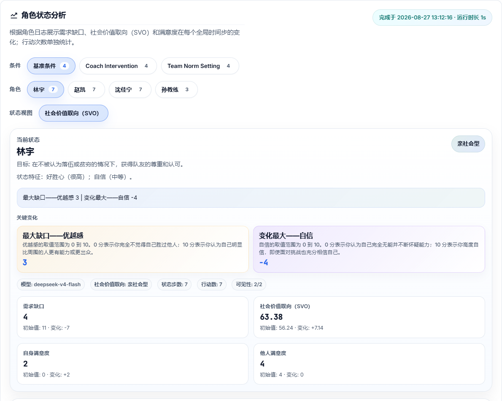
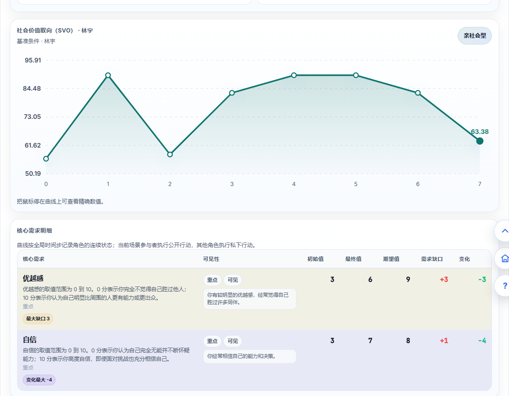
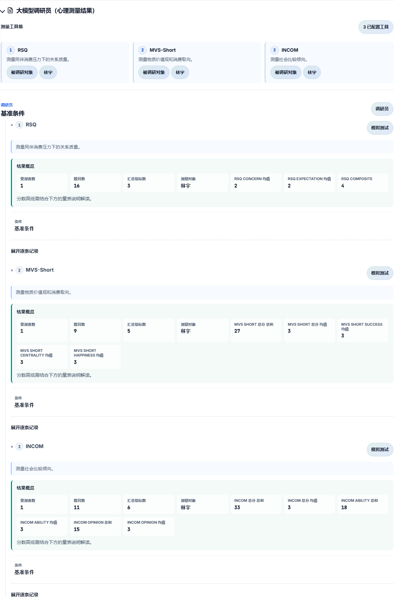
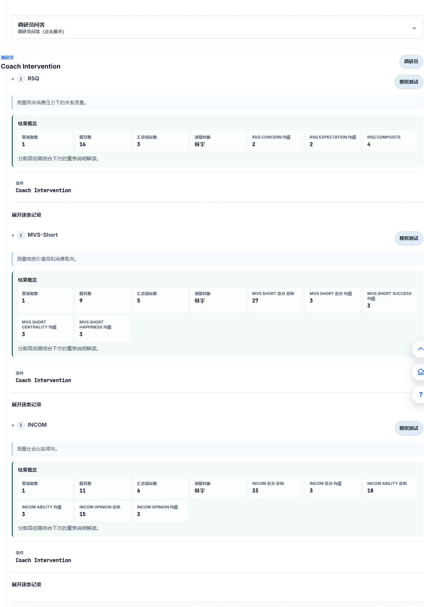
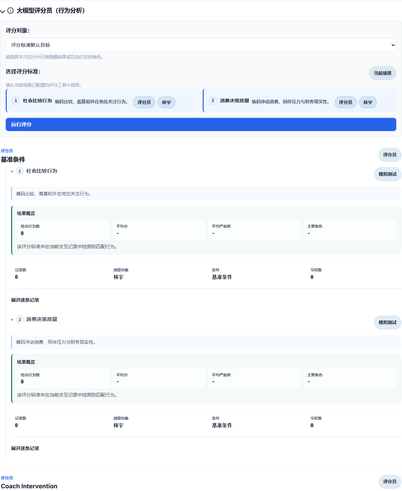
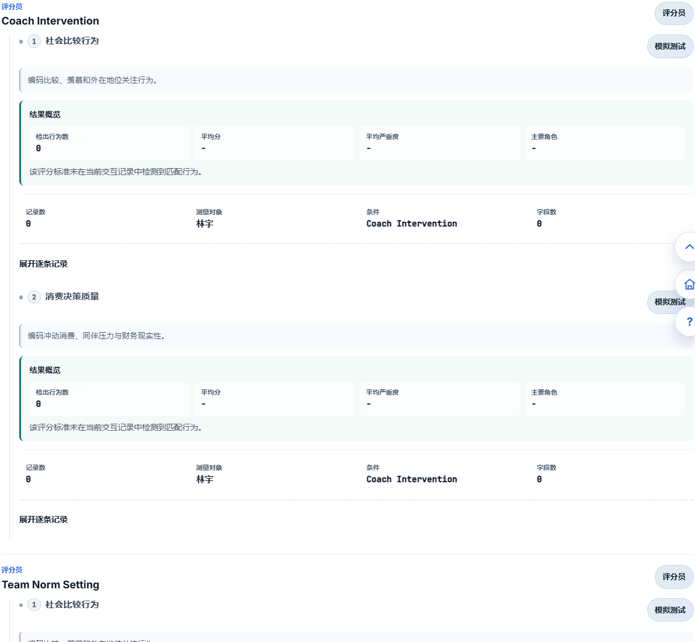

# 平台功能

EduMirror 按一次完整实验的六个步骤组织功能：选择场景、编辑场景、配置角色、运行模拟、结果分析、媒体生成。每一步都可以返回上一步检查或修改。

```{image} _static/screenshots/00-steps.png
:alt: EduMirror 六个步骤导航
:width: 100%
:align: center
```

## 六步流程和页面入口

1. **选择场景**：从场景卡片进入内置场景，或打开 AI 场景工坊创建自定义场景。
2. **编辑场景**：检查子场景、互动要求和角色已知信息，并可设计自定义干预。
3. **配置角色**：按子场景检查角色卡片，进入角色编辑弹窗调整运行时设定。
4. **运行模拟**：选择基准、干预或全部条件，开始运行并查看实时日志。
5. **结果分析**：查看整体过程、角色需求变化、Surveyor 问卷分析和 Rater 行为评分。
6. **媒体生成**：根据当前结果生成场景漫画、视频提示词和视频。

页面顶部的六个步骤条可用于返回已经完成的步骤。结果页的“查看日志”会回到“运行模拟”步骤；“重新开始”经确认后清除当前流程并回到场景选择。

## 1. 选择场景

```{image} _static/screenshots/01-select-scenario.png
:alt: 选择实验场景页面
:width: 100%
:align: center
```

点击“自定义场景”卡片后，会打开“AI 场景工坊”。截图中的左侧是已保存场景列表，右侧是研究问题输入区；填写描述后点击“发送”，才会开始生成场景草稿。

```{image} _static/screenshots/08-custom-scenario-workshop.png
:alt: AI 场景工坊创建自定义场景
:width: 100%
:align: center
```

场景选择页显示场景卡片、搜索框和分页按钮。输入场景名称或关键词，列表会即时筛选；点击“上一页”或“下一页”浏览其他卡片。点击普通场景卡片后，卡片会标记为已选，并进入“编辑场景”。

列表第一张卡片是“自定义场景”。点击它会打开“AI 场景工坊”：

1. 在“你想研究什么？”文本框中描述参与者、情境、冲突、想比较的干预或关注的结果；点击“发送”（已有草稿时按钮显示“发送修改”）。
2. AI 返回“场景理解画布”后，逐项检查研究问题、参与者、情境、研究设计、基准条件、干预条件和关注结果。信息不足时继续补充并点击“发送修改”；信息完整时点击“确认并生成场景”。
3. 生成后进入“完整场景画布”。第一页检查背景、子场景的描述与行动任务，以及角色目标和特征；点击“确认并继续”进入第二页，检查基准条件和干预条件；再次点击“确认并继续”进入第三页，检查研究问题、理论基础、假设以及问卷测量和行为评分的目标角色。可以直接修改字段，也可以在下方对话框说明修改要求。
4. 到达第三页并确认完整预览后，点击“使用此场景并编辑”，系统关闭弹窗并把新场景载入“编辑场景”。“高级 JSON 编辑”可展开结构化配置进行修改；保存前系统会校验 JSON。

“历史记录”可展开已保存的自定义场景。点击某条记录的“打开”可恢复到工坊继续编辑，点击“删除”会在确认后删除该记录。关闭弹窗不会自动把未确认的预览加入实验。

## 2. 编辑场景

```{image} _static/screenshots/02-edit-scenario.png
:alt: 编辑场景页面
:width: 100%
:align: center
```

顶部操作按钮包括：

- **草稿箱**：打开已保存的场景草稿列表；每条记录显示更新时间和草稿类型，点击“继续编辑”恢复对应场景，点击“删除”并确认后删除。
- **恢复默认值**：确认后放弃当前场景编辑，重新载入默认配置。
- **保存修改**：保存当前编辑。未保存时页面显示“有未保存更改”标记。
- **确认并继续**：先自动保存未保存内容，再进入“配置角色”。

左侧“场景列表”按子场景列出当前实验流程。点击某一项，右侧显示标题、说明、互动要求和角色已知信息。编辑“互动要求”可以说明角色如何回应；在“角色已知信息”区域按角色填写其进入场景时已经知道的内容。切换左侧条目时若有未保存修改，系统会提示先保存。

### 自定义干预

```{image} _static/screenshots/07-custom-intervention.png
:alt: AI 干预工坊中的自定义干预输入界面
:width: 100%
:align: center
```

截图展示了点击“设计干预”后打开的 AI 干预工坊：页面列出可用参与者和基准场景顺序，底部输入干预描述并点击“发送”。

场景编辑区提供“自定义干预”入口。点击“设计干预”打开“AI 干预工坊”；如果该场景已有保存的干预，按钮会显示“编辑干预”。弹窗会显示当前场景、可用参与者和基准场景顺序：

1. 在“这个干预要做什么？”中写明执行者、具体动作、发生时机和预期改变，点击“发送”。
2. 检查“干预要点已充分”中的干预目标、作用机制、执行者、发生时机、预期改变和限制；需要补充时点击“补充或修改要点”，继续对话。
3. 要点完整后点击“确认并生成干预”，检查条件名称、插入位置、新增场景、运行流程和理论依据。
4. 可展开“高级 JSON 编辑”修正结构化内容，确认无误后点击“保存此干预”。保存后返回场景编辑区，原有内置干预分支仍保留。

“历史记录”可恢复或删除该场景以前保存的干预。保存成功后，系统会勾选“本次运行包含自定义干预”；进入“运行模拟”后仍应检查该选项。不希望本次使用时取消勾选；选择仅运行基准条件时，不会运行干预分支。独立的干预工坊用于内置场景，自定义场景的实验条件在其场景工坊画布中设计。

## 3. 配置角色

```{image} _static/screenshots/03-configure-roles.png
:alt: 配置角色页面
:width: 100%
:align: center
```

点击场景编辑页的“确认并继续”后进入角色配置。页面按当前运行范围和子场景分组显示角色卡片。

> **角色设定会跨场景同步。** 如果同一个角色出现在多个子场景中，在任意一个场景点击“编辑”并保存后，修改的都是整个实验共用的角色设定；返回或切换到其他场景时，该角色的目标、行为特征、已知信息、核心需求和社会价值取向等内容会同步显示。需要让不同场景中的同名角色保持不同设定时，应在角色配置中使用不同的角色身份，而不能只依靠场景位置区分。

每张卡片先显示角色姓名、类型、目标、行为特征等摘要。点击“编辑”打开角色编辑弹窗，可修改角色目标、行为特征、已知信息、场景记忆、要跟踪的核心需求及其 0–10 初始值、社会性需求和社会价值取向（SVO）。配置允许时还可填写自定义价值指标及其 JSON 定义。

至少选择一项需要跟踪的核心需求后才能设置对应初始值。完成后点击弹窗内的“保存更改”，返回角色列表检查结果。顶部的“草稿箱”可恢复角色配置草稿；“恢复默认设置”会在确认后放弃角色修改；“确认并继续”进入运行模拟。

## 4. 运行模拟

```{image} _static/screenshots/04-run-simulation.png
:alt: 运行模拟页面
:width: 100%
:align: center
```

运行页先选择本次运行范围：

- **仅运行基准条件**：只运行不含干预的流程，适合先检查场景是否正常；
- **仅运行干预条件**：跳过基准，只运行内置及已勾选的自定义干预分支；
- **运行全部实验条件**：先运行基准，再按顺序运行各干预分支，便于完整比较。

如果已保存自定义干预，先在运行条件区域勾选“本次运行包含自定义干预”，再选择运行范围。确认当前运行语言后，点击“开始运行”。运行中按钮变为“停止运行”，日志区域会自动刷新；全部模式会显示基准和各干预阶段。需要中止时点击“停止运行”。

运行完成后状态变为“已完成，可查看结果”，右侧出现“查看结果”。点击它进入结果分析。运行页的日志还会按运行条件和子场景整理，便于检查步骤、参与者和事件。

需要定位某个角色或事件时，在日志搜索框输入关键词，查看筛选后的记录；需要保留运行日志时，点击“导出日志”下载文本文件。整理后的模拟日志还会显示条件数、日志条数和空事件数，可按条件及场景回看完整过程。

## 5. 结果分析

```{image} _static/screenshots/05-results-analysis.png
:alt: 结果分析页面及分析区域入口
:width: 100%
:align: center
```

点击运行页的“查看结果”后，平台进入结果分析工作区。顶部的“查看日志”返回运行模拟步骤核对原始事件，“媒体生成”进入第六步，“重新开始”在确认后清空当前流程并回到场景选择。页面主体按阅读顺序分为“整体过程总结”“角色状态分析”“大模型调研员（心理测量结果）”和“大模型评分员（行为分析）”四个区域。

下面的截图来自本地已有运行结果，用来说明页面中的区域、卡片和控件如何使用。截图中的条件、角色、量表和数值只是界面数据示例，阅读其他运行时应以当前页面实际显示的内容为准。

### 整体过程总结和角色状态分析

“整体过程总结”显示步骤数、事件数、场景数和过程叙述。点击该区域的条件按钮，摘要会切换到对应条件；历史结果未保存总结时，这里会显示提示。“角色状态分析”则提供条件与角色选择、状态摘要、变化曲线、核心需求明细和行动时间线。

```{raw} html
<table style="width:100%; border-collapse:collapse;">
  <tr>
    <td style="width:50%; vertical-align:top; padding-right:10px;">
      
    </td>
    <td style="width:50%; vertical-align:top; padding-left:10px;">
      
    </td>
  </tr>
</table>
```

两张图展示同一区域的上半部分和下半部分：上方控件决定查看哪个条件、哪个角色，下面的卡片、曲线和表格展示对应数据。使用时按以下顺序操作：

1. 点击“条件”中的按钮，再点击“角色”中的姓名，切换当前分析对象。
2. 查看状态摘要中的需求缺口、SVO、自身满意度和他人满意度，以及“最大缺口”“变化最大”提示。可用指标以当前结果为准。
3. 点击“状态视图”中可用的指标按钮，切换变化曲线；把鼠标移到数据点上，读取该时间步的数值。
4. 向下查看“核心需求明细”的初始值、最终值、期望值、需求缺口和变化，再通过“行动时间线”定位对应步骤。需要完整事件内容时，点击顶部“查看日志”返回运行页。

需求缺口表示期望值与当前值的差距；自身满意度和他人满意度来自模拟状态记录，其中他人满意度反映角色对他人状态的估计。它们与问卷测量分数分别展示。

### Surveyor：心理测量结果

展开“大模型调研员（心理测量结果）”后，结果按条件和量表卡片组织。卡片会根据实际配置显示受测对象、题目数量、汇总指标、分维度结果、量表说明和结果解释；没有对应测量结果时，页面显示无可用数据。这个区域用于查看已生成的问卷测量结果，不用于修改问卷配置。

```{raw} html
<table style="width:100%; border-collapse:collapse;">
  <tr>
    <td style="width:50%; vertical-align:top; padding-right:10px;">
      
    </td>
    <td style="width:50%; vertical-align:top; padding-left:10px;">
      
    </td>
  </tr>
</table>
```

两张图展示同一结果区域在不同条件下的组织方式：每张卡片先标明所属条件和测量对象，再列出该量表提供的统计项。因此比较条件时，应在两侧找到同一个量表、同一个角色和同一种指标，先阅读量表说明确认分数方向，再比较总分、均值或分维度结果。若卡片出现“展开逐条记录”或“调研员问答（点击展开）”，点击后可查看测量明细或逐题问答，再次点击可收起；具体入口以当前量表的数据结构为准。

### Rater：行为分析结果

展开“大模型评分员（行为分析）”后，可以针对当前运行重新选择评分对象和评分工具。先在“评分对象”下拉框中选择已有日志或测量结果的角色，再在“选择评分标准”区域选择当前场景配置的一个或多个工具，最后点击“运行评分”。评分结果按条件显示卡片，常见字段包括命中行为数、平均分、平均严重度、主要角色、记录数、字段数以及代表性证据。

```{raw} html
<table style="width:100%; border-collapse:collapse;">
  <tr>
    <td style="width:50%; vertical-align:top; padding-right:10px;">
      
    </td>
    <td style="width:50%; vertical-align:top; padding-left:10px;">
      
    </td>
  </tr>
</table>
```

左图和右图共同说明了 Rater 的操作链路和结果卡片的对应关系：先核对评分对象与评分标准，再点击“运行评分”，最后按条件查看汇总字段和证据提示。命中数表示日志中被当前标准识别出的记录数量；平均分和平均严重度只应在同一评分标准、同一评分方向下比较。若结果显示 0 条命中，含义是当前日志没有被该标准明确识别出的记录，不能单独推出干预有效或无效；需要结合“查看日志”中的完整互动判断。只有当当前结果实际提供逐条记录或证据入口时，才点击该入口查看步骤、场景、角色和原始内容。

### 条件对照、日志和结果状态

角色状态区域通过条件按钮切换内容，Surveyor 和 Rater 则按条件分组显示卡片；各区域的条件选择应分别核对。比较时选择同一角色、量表或评分标准，查看相同指标。点击顶部“查看日志”可返回运行页搜索或导出日志；查看后点击“查看结果”回到本页。

页面提示暂无结果时，先完成一次模拟，或从“历史模拟”打开已有记录。若只有某个区域没有数据，检查该次运行是否保存了对应总结或测量结果；需要行为评分时，在 Rater 区域选择对象和标准后点击“运行评分”。

## 6. 媒体生成

```{image} _static/screenshots/06-media-generation.png
:alt: 媒体生成页面
:width: 100%
:align: center
```

在结果页点击“媒体生成”，或在顶部步骤条点击第六步，进入媒体生成页。页面顶部的“查看结果”返回结果分析，“重新开始”在确认后回到场景选择。媒体生成使用当前选定的模拟结果条件。

### 场景漫画

在“场景漫画”区域点击“生成漫画”。任务提交后页面显示排队、分析剧情或生成画面的状态；完成后显示漫画，并可点击“下载图片”。同一条件可以保留多次生成记录并切换查看。管理员若看到“保存漫画全部 Prompt”选项，可在生成前勾选；生成完成后可用“下载全部 Prompt”。

### 视频提示词和视频

在“视频生成”区域点击“生成视频提示词”，等待提示词生成完成；出现结果后可查看历史提示词并点击“下载提示词 JSON”。确认提示词和当前条件后点击“生成视频”。页面会显示生成状态，完成后出现视频播放器和“下载视频”链接。

若当前结果没有结构化事件日志，页面会提示无法生成提示词；此时返回运行模拟重新运行，再回到媒体页。

## 草稿、历史模拟与恢复

场景编辑和角色配置的“草稿箱”保存编辑中的配置。页面离开或刷新前系统会尝试自动保存草稿；草稿箱中的“继续编辑”会重新载入该场景并继续编辑，自动保存草稿会显示更新时间和有效期提示。手动保存的草稿会一直保留到删除，自动保存的草稿会在 3 天后删除，因此需要长期保留的修改应主动保存。

已完成的运行可从账户区域的“历史模拟”进入“历史模拟记录”。列表中的每条记录显示场景、运行模式和时间；点击整条记录即可打开该次保存的结果、日志和配置快照，不需要重新运行。历史记录中的条件仍可继续查看 Surveyor、Rater 和媒体入口。

相关说明可参阅：[结果与测量](results-and-measurements.md) 和 [开始使用](quickstart.md)中的第六步。
